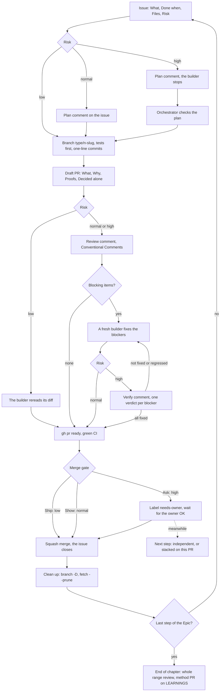
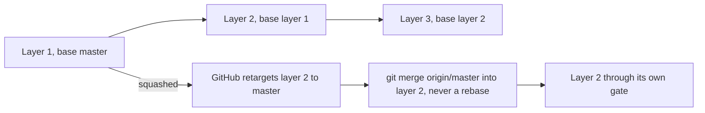

# Workflow

How a step of pgcast goes from its issue to `master`, on one page. Each box links to the skill that holds its rules; this page repeats none of them.

An orchestrator (the main session) runs each step with three agents: `builder` writes the code, `branch-reviewer` reviews it read-only, `chores` does the mechanical work. The owner reads what each step leaves on GitHub and gives the OK where the risk is high.

## The flow

| Stage | What it leaves on GitHub | Skill |
|---|---|---|
| Issue | the brief: **What**, **Done when**, **Files**, **Risk** ([template](../.github/ISSUE_TEMPLATE/task.md)) | [`run-step`](../.agents/skills/run-step/SKILL.md) § Issue body |
| Plan | a comment on the issue, before any code | [`plan-and-proofs`](../.agents/skills/plan-and-proofs/SKILL.md) |
| Branch and commits | `fix/26-upsert-update-values`; one-line commits in plain English; a bug's failing test before its fix | [`pr-shape`](../.agents/skills/pr-shape/SKILL.md) |
| Draft PR | `Closes #n`, **What** · **Why** · **Proofs** · **Decided alone** | [`plan-and-proofs`](../.agents/skills/plan-and-proofs/SKILL.md) |
| Review, fixes, verify | one comment per round; blockers marked `→ fixed in <sha>` | [`review-comments`](../.agents/skills/review-comments/SKILL.md) |
| CI | none while in draft; **CI passed** on the last commit | [`ci-gate`](../.agents/skills/ci-gate/SKILL.md) |
| Gate, squash, clean-up | one commit per PR on `master` | [`merge-gate`](../.agents/skills/merge-gate/SKILL.md) |

## Risk

The issue's **Risk** sets the plan, the review and the gate (detail: skill `run-step` § Risk).

| Risk | For | Plan | Review | Gate |
|---|---|---|---|---|
| `low` | docs, method, CI only | none | CI; the builder rereads its diff | **Ship**: merged on green CI |
| `normal` | tests, an opt-in addition | posted, the builder goes on | `branch-reviewer`; fixes of blockers | **Show**: merged on green CI, read by the owner afterwards |
| `high` | `core.ts`, `transaction.ts`, existing public types, default codegen output | posted, the builder waits for the check | `branch-reviewer` with a lens; fixes; verify | **Ask**: `needs-owner`, the owner's OK before merging |

## A stack

Steps of one feature that depend on each other become a stack of at most three PRs, each targeting the branch below (skill `pr-shape` § Stacking).

## End of chapter

When the Epic's last step is merged: a review of the whole merged range, then a method PR that judges each line of [LEARNINGS.md](LEARNINGS.md) and closes the Epic (skill `run-step` § End of chapter).

## Releases

The core's release, `@pgcast/pgcast`, goes in this order; an extension's, below. The tag and the deployment stay the owner's (`AGENTS.md` § Stop points).

1. **The pre-release pass**, before every publication:
   - a range review of every PR merged since the last pass;
   - an audit of `npm pack` (files, README, `package.json` fields) and of the docs site: each feature's "From x.y.z." in EN and FR, no current-version number in the README or the docs;
   - a fix for each finding, merged before the version PR.
2. **The version PR**, by hand, reviewed like any PR and merged by the session (models: #624, and #568 for one that also carries an advisory):
   - `version` in `package.json`, in both root entries of `package-lock.json` and in the `..` entry of `website/package-lock.json`;
   - `CHANGELOG.md`: `## [Unreleased]` becomes `## [x.y.z] - <date>`, under a new empty `## [Unreleased]`.
3. **The owner** pushes the tag `v<version>` on the version commit, approves the `npm` deployment, then creates the GitHub release from its changelog section.
4. **The session** checks the registry (version, `latest`, provenance), closes the milestone, and lists the existing advisories before publishing one, so none is published twice.

A release tag queues a deployment to the GitHub environment `npm`. After the owner approves it, the [release workflow](../.github/workflows/release.yml) checks that the tagged commit is on master and that the tag matches the package manifest. It publishes that package with npm trusted publishing (OIDC) and provenance.

### Owner setup

1. **Protect the GitHub environment before configuring npm.** In Settings › Environments › `npm`, set the owner as the sole required reviewer, turn off administrator bypass and restrict deployments to the two tag rules `v*` and `@pgcast/*@*`.
   GitHub creates a missing `npm` environment without protection rules. If npm already trusts the workflow, a release tag can publish without approval while that environment is unprotected. [GitHub environment creation](https://docs.github.com/en/actions/how-tos/deploy/configure-and-manage-deployments/manage-environments#creating-an-environment)
2. Trusted publishing is configured in an existing package’s npm settings. For a new extension, complete the pre-release pass and merge its version PR. At that commit, install the root dependencies, then run `npm ci` and `npm publish --access public` by hand in the extension folder with 2FA. Skip that version’s release tag. [npm trusted publishing setup](https://docs.npmjs.com/trusted-publishers/#configuring-trusted-publishing)
3. For a package that still needs trusted publishing, wait until its next version is ready. Open the package’s Settings › Trusted publishing on npmjs.com. Choose GitHub Actions, owner `AlexandreDemartin`, repository `pgcast`, workflow `release.yml` and environment `npm`. Allow direct `npm publish`. Under Publishing access, require two-factor authentication and disallow tokens. Revoke obsolete publish tokens.
4. Push the tag on the merged version commit and approve the deployment in time for the first trusted publish to succeed within two days of creating the configuration. Otherwise the configuration expires. [npm configuration expiry](https://docs.npmjs.com/trusted-publishers/#trusted-publisher-configuration-expiry)

### An extension

Each extension under `@pgcast/*` (`adapters/<driver>/`, later `tools/<name>/`) is released apart from the core, under its own version (decision [013](decisions/013-package-model.md)).

- **Its tag**: `@pgcast/<name>@<version>`, on its version commit, `@pgcast/adapter-postgres-js@0.1.0`; the core keeps `v<version>`.
- **Before it**: the pre-release pass of step 1, on its range and its `npm pack`.
- **Its version PR**: `version` in its `package.json` and both root entries of its `package-lock.json`; its own `CHANGELOG.md`, as the core's above.
- **The core's `CHANGELOG.md`**: one line, at its first publication, linking to its changelog.
- **After the first publication**, the owner pushes the extension tag and approves its `npm` deployment. The workflow publishes from the extension folder. Check the version, `latest` and provenance on npm.

## Commands

The short list is in `AGENTS.md` § Commands; each command in full. CI uses npm 10 (Node 20 and 22) and npm 11 (`lts/*`). Day-to-day development is on Node 22; in CI the test database is a GitHub Actions service container.

| Command | Role |
|---|---|
| `npm ci` | install (npm ≥ 10) |
| `npm run build` | `tsc` (CJS, ES2019) + ESM wrappers |
| `npm run lint` | ESLint 9 (flat config) on `src/`, `scripts/` and the docs site's own code (`website/*.mjs`, `website/*.ts`, `website/.vitepress/**/*.ts`) |
| `npm run typecheck` | `tsc` on the lib (its declarations go to `node_modules/.cache/pgcast`), on `test/`, and on the fixture's generated output (`test/generated/`) against those declarations |
| `npm test` | Vitest: unit and integration (`TEST_DATABASE_URL` required, `useTestDatabase()` in `test/helpers/db.ts`) |
| `npm run test:watch` | Vitest in watch mode |
| `npm run test:types` | emits the declarations of `src/db`, then the Vitest type tests (`test/types/*.test-d.ts`, `expectTypeOf`) on the fixture's generated schema; then `test/types-opt-in` emits a library's declarations, each `import("…")` naming a public module (`scripts/check-declarations.mjs`), and `test/types-order` compiles, in a program of its own, types that depend on the order `tsc` checks them in. Finally `test/types-opt-in/legacy` checks the literal `false` aggregate declaration in isolation |
| `npm run bench:types` | compile cost of `bench/` (typed queries on the fixture's schema): `Instantiations` and `Types`, minus a floor without pgcast, compared with `bench/baseline.json`; fails above +20 %, below −5 % or if the TypeScript version differs; `-- --update` rewrites the baseline |
| `npm run check:floor` | after `build`: every `.d.ts` that `npm pack` lists parses with TypeScript 4.1.6, the `typescript` peer's floor, a consumer on 4.1 compiles against them with `skipLibCheck`, and their lib check finds no error but `Buffer<ArrayBuffer>`; fetches 4.1.6 and its `@types` once into `node_modules/.cache`; a directory argument checks an unpacked package instead |
| `npm run check:agents` | consistency of skills and agents, § Architecture against `src/`, a `CHANGELOG.md` § Deprecated line (any release) per deprecation message, no `CHANGELOG.md` entry written twice in a release, the summary of `docs/CHARACTERISATION-REPORT.md` recounted from its sections, tests of the `guard` hook, of the release-folder resolver and of these checks |

An extension's checks run from its folder, after the root's `npm ci && npm run build`, whose install, helpers and `db.d.ts` its tests use: `npm ci`, `npm test`, `npm run test:types` (its README § Development), and `npm pack --dry-run` when its `files` or its build change.

## Later

- release-please for pgcast's version PRs.
- Native stacked PRs, once `gh stack` stops rebasing and forcing branches.
