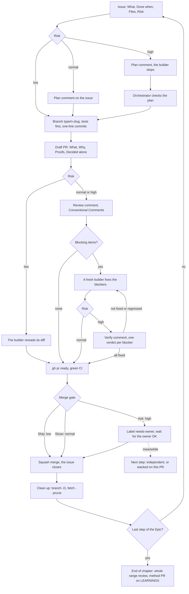
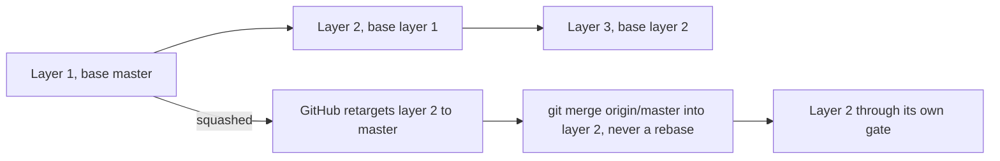

# Workflow

How a step of pgcast goes from its issue to `master`, on one page. Each box links to the skill that holds its rules; this page repeats none of them.

An orchestrator (the main session) runs each step with three agents: `builder` writes the code, `branch-reviewer` reviews it read-only, `chores` does the mechanical work. The owner reads what each step leaves on GitHub and gives the OK where the risk is high.

## The flow

| Stage | What it leaves on GitHub | Skill |
|---|---|---|
| Issue | the brief: **What**, **Done when**, **Files**, **Risk** ([template](../.github/ISSUE_TEMPLATE/task.md)) | [`run-step`](../.agents/skills/run-step/SKILL.md) § Issue body |
| Plan | a comment on the issue, before any code | [`plan-and-proofs`](../.agents/skills/plan-and-proofs/SKILL.md) |
| Branch and commits | `fix/26-upsert-update-values`; one-line commits in plain English; a bug's failing test before its fix | [`pr-shape`](../.agents/skills/pr-shape/SKILL.md) |
| Draft PR | `Closes #n`, **What** · **Why** · **Proofs** · **Decided alone** | [`plan-and-proofs`](../.agents/skills/plan-and-proofs/SKILL.md) |
| Review, fixes, verify | one comment per round; blockers marked `→ fixed in <sha>` | [`review-comments`](../.agents/skills/review-comments/SKILL.md) |
| CI | none while in draft; **CI passed** on the last commit | [`ci-gate`](../.agents/skills/ci-gate/SKILL.md) |
| Gate, squash, clean-up | one commit per PR on `master` | [`merge-gate`](../.agents/skills/merge-gate/SKILL.md) |

## Risk

The issue's **Risk** sets the plan, the review and the gate (detail: skill `run-step` § Risk).

| Risk | For | Plan | Review | Gate |
|---|---|---|---|---|
| `low` | docs, method, CI only | none | CI; the builder rereads its diff | **Ship**: merged on green CI |
| `normal` | tests, an opt-in addition | posted, the builder goes on | `branch-reviewer`; fixes of blockers | **Show**: merged on green CI, read by the owner afterwards |
| `high` | `core.ts`, `transaction.ts`, existing public types, default codegen output | posted, the builder waits for the check | `branch-reviewer` with a lens; fixes; verify | **Ask**: `needs-owner`, the owner's OK before merging |

## A stack

Steps of one feature that depend on each other become a stack of at most three PRs, each targeting the branch below (skill `pr-shape` § Stacking).

## End of chapter

When the Epic's last step is merged: a review of the whole merged range, then a method PR that judges each line of [LEARNINGS.md](LEARNINGS.md) and closes the Epic (skill `run-step` § End of chapter).

## Later

- release-please for pgcast's npm versions, once releases start.
- Native stacked PRs, once `gh stack` stops rebasing and forcing branches.
